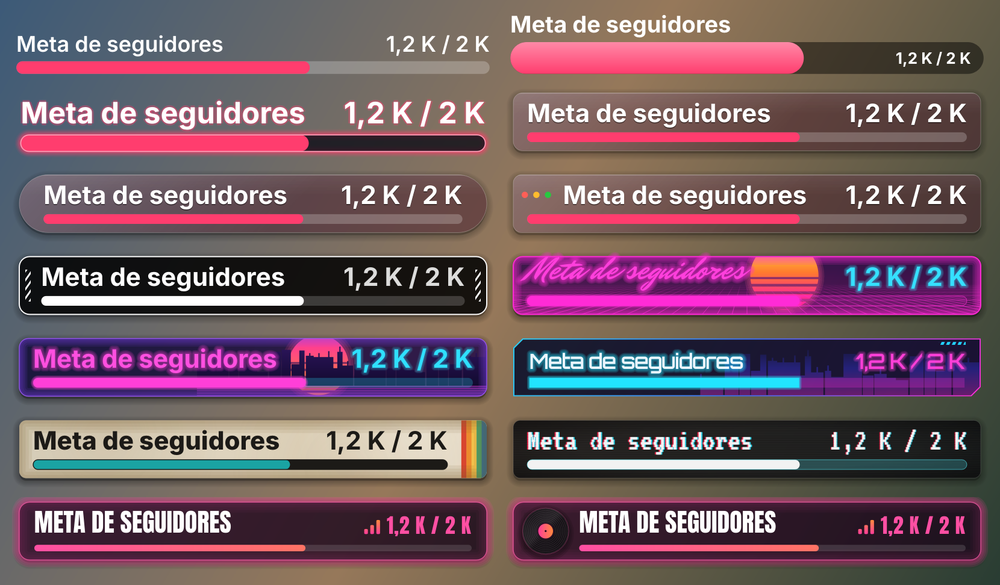

<div align="center">

# 🎯 AC Goal Bar

**Una barra de progreso nativa para OBS que avanza en vivo hacia tu meta de me gusta, suscriptores o seguidores en YouTube, Twitch o Kick, y celebra cuando la alcanzas.**

[](../../releases/latest)


[](LICENSE)

[English](README.md) · **Español**



[**⬇️ Descargar**](../../releases/latest) &nbsp;·&nbsp; [Instalar](#-instalar) &nbsp;·&nbsp; [Qué incluye](#-qué-incluye) &nbsp;·&nbsp; [Preguntas frecuentes](#-preguntas-frecuentes)

</div>

---

Una fuente nativa de OBS (sin fuente de navegador, sin página web, sin app aparte). YouTube y Kick no necesitan cuenta ni claves; Twitch se conecta una vez con un código.

## ✨ Qué incluye

| | Función | Qué hace |
|:-:|---------|----------|
| 📊 | **Fuente «Barra de meta»** | Una fuente de OBS con título, valor actual / meta y una barra que se llena con una animación suave. Estilos: Minimalista, Intenso y Neón (solo la barra) y los mismos estilos de tarjeta que multi-chat y Music Now Playing — Cristal, Píldora, Ventana macOS, Línea, Synthwave, Ciudad neón, Cyberpunk, Retro y Glitch (VHS, con sus saltos) — y los dos estilos GTA 6 (Vice City) de Music Now Playing, uno con vinilo —, con opacidad del fondo, color de acento y de texto, y tamaño |
| ▶️ | **YouTube, modo público** | Lee los me gusta y los suscriptores del directo desde la página pública del canal (`@usuario`), sin iniciar sesión |
| 🟣 | **Twitch** | Seguidores y suscriptores con la API oficial. Conectas tu cuenta con un código en twitch.tv/activate |
| 🟢 | **Kick** | Seguidores y espectadores de cualquier canal, sin cuenta ni app de Kick (endpoint público no documentado, ver abajo) |
| ✍️ | **Modo manual** | Escribes el valor actual a mano; siempre disponible |
| 🎉 | **Celebración** | Al cumplir la meta: brillo y confeti sobre la barra |
| 🎬 | **Mostrar una fuente** | Muestra una fuente de la escena (imagen, texto, audio o video). Audio y video se reproducen desde el inicio y se ocultan al terminar |
| 🔀 | **Más acciones (opcionales)** | Cambiar de escena (y volver tras N s), guardar un clip del búfer de repetición, tomar una captura. Todas desactivadas por defecto; la prueba nunca guarda clips |
| ⏭️ | **Siguiente meta automática** | Tras la celebración, la meta sube según el incremento que elijas |
| ⌨️ | **Atajos de teclado** | «Barra de meta: Probar celebración» y «Barra de meta: Reiniciar meta», por fuente |
| 🔄 | **Actualizaciones** | Revisa GitHub una vez al día e instala la versión nueva al reiniciar OBS, si aceptas |
| 🌍 | **Traducciones** | Interfaz en inglés y español |

> [!NOTE]
> **YouTube redondea los suscriptores** (por ejemplo, 12,3 K), incluso para el dueño del canal. Por eso una meta de suscriptores se ajusta al siguiente valor que YouTube puede mostrar. Los me gusta son exactos y son la métrica por defecto.

## 📦 Instalar

Descarga el paquete de tu sistema desde **[Releases](../../releases/latest)** y **cierra OBS antes** (OBS no puede reemplazar un plugin que ya cargó).

| | macOS 13+ (Apple Silicon) | Windows x64 (OBS 33+) | Linux x86_64 |
|---|---|---|---|
| **Archivo** | `obs-goal-bar-<versión>-macos-arm64.zip` | `obs-goal-bar-<versión>-windows-x64.zip` | `obs-goal-bar-<versión>-linux-x86_64.tar.gz` |
| **Queda** | `obs-goal-bar.plugin` | la carpeta `obs-goal-bar` | la carpeta `obs-goal-bar` |
| **Cópialo en** | `~/Library/Application Support/obs-studio/plugins/` | `C:\ProgramData\obs-studio\plugins\` | `~/.config/obs-studio/plugins/` |
| **Después** | Ejecuta el comando de la Terminal de abajo (una vez) | — | — |

Cada paquete trae también sus pasos en `INSTALL.txt`. Abre OBS: en **Ayuda → Archivos de registro → Ver registro actual** deberías ver `[obs-goal-bar] loaded`.

**macOS:** en Finder, pulsa <kbd>⌘</kbd> <kbd>⇧</kbd> <kbd>G</kbd> y pega la ruta; crea la carpeta `plugins` si no existe. El paquete no está firmado con una cuenta de desarrollador de Apple de pago, así que quita la marca de cuarentena una vez:

```bash
xattr -dr com.apple.quarantine ~/Library/Application\ Support/obs-studio/plugins/obs-goal-bar.plugin
```

**Windows:** debe quedar `C:\ProgramData\obs-studio\plugins\obs-goal-bar\bin\64bit\obs-goal-bar.dll` (`ProgramData` está oculta: escribe la ruta en la barra del Explorador). El token de renovación de Twitch se guarda en el Administrador de credenciales de Windows.

**Linux:** se compila en Ubuntu 24.04 contra el OBS del [PPA oficial](https://launchpad.net/~obsproject/+archive/ubuntu/obs-studio).

```bash
mkdir -p ~/.config/obs-studio/plugins
tar -xzf obs-goal-bar-<versión>-linux-x86_64.tar.gz -C ~/.config/obs-studio/plugins
```

En Linux, el inicio de sesión de Twitch necesita `libsecret` y un Secret Service activo (GNOME Keyring o KWallet); sin él, el token no se guarda (nunca queda en texto plano).

**Desinstalar:** borra `obs-goal-bar.plugin` (macOS) o la carpeta `obs-goal-bar` (Windows, Linux) de la carpeta de plugins de arriba.

## 🚀 Uso en 5 pasos

1. **Añade la fuente.** En una escena, pulsa **+** y elige **Barra de meta**.
2. **Elige la plataforma.** **Manual**, **YouTube** (escribe tu `@usuario`), **Twitch** (pulsa **Conectar Twitch** e ingresa el código en twitch.tv/activate) o **Kick** (escribe el nombre del canal; ver abajo).
3. **Fija la meta.** Elige la métrica y escribe la **Meta**.
4. **Decide qué pasa al cumplirla.** En **Al cumplir la meta**: animación, una fuente para mostrar y la siguiente meta automática. Pulsa **Probar celebración** para verlo.
5. **Asigna atajos (opcional).** En **Ajustes → Atajos**, busca la fuente y asigna «Probar celebración» y «Reiniciar meta».

> [!TIP]
> La barra siempre muestra actual / meta, igual que su texto. **Reiniciar meta** vuelve a armar la celebración de la meta actual (y, con «Siguiente meta automática», sube por el incremento una meta ya cumplida). Nunca dispara la celebración por sí sola, aunque el valor ya esté en la meta.

### 🟣 Twitch

Los seguidores funcionan con cualquier cuenta. Los suscriptores necesitan un canal Afiliado o Partner de Twitch; si no, la barra lo indica.

### 🟢 Kick

Elige **Kick** y escribe el nombre del canal (o pega su URL de kick.com). No necesitas cuenta, app ni credenciales de Kick.

Métricas: **Seguidores** (disponibles en todo momento) y **Espectadores** (se muestran mientras el canal está en directo; si no, «Sin directo»). Los suscriptores de pago no se ofrecen: Kick no los publica en este endpoint. La barra se actualiza cada 20 segundos aproximadamente y espera más (hasta 5 minutos) si Kick limita o bloquea las solicitudes.

> [!WARNING]
> Los datos de Kick vienen de un endpoint público **no documentado** (`kick.com/api/v2/channels/<canal>`), el mismo que usa la web de Kick. No forma parte de su API oficial, está detrás de Cloudflare y puede cambiar o dejar de funcionar en cualquier momento. Si Kick bloquea la solicitud, la barra muestra «Kick bloqueó la solicitud» en lugar de un valor falso.

## 🔄 Actualizaciones

- **Automáticas.** Al abrir OBS, el plugin consulta la última versión publicada en GitHub, como mucho una vez al día. Si hay una nueva, te muestra un aviso con las notas de la versión y tres opciones: **Instalar al reiniciar**, **Más tarde** u **Omitir esta versión**.
- **Manual.** En **Herramientas → Goal Bar: Buscar actualizaciones**.
- **Cómo se aplica.** Al elegir **Instalar al reiniciar**, el paquete se descarga de las Releases de este repositorio en GitHub y se verifica con el SHA-256 que publica GitHub. Se instala cuando cierras OBS y queda activo al volver a abrirlo. Si algo falla, se restaura la versión anterior.

> [!NOTE]
> Solo se actualiza sola una instalación hecha como en las instrucciones de arriba (no dentro de la carpeta del programa OBS ni desde un paquete de la distribución), y tu usuario debe poder escribir en ella. Si no, el aviso enlaza a la página de la versión para descargarla a mano.

## ❓ Preguntas frecuentes

<details>
<summary><b>En YouTube la barra dice «Sin directo» o no se mueve</b></summary>

Los me gusta y los suscriptores de YouTube se leen de tu página pública `/@usuario/live`, así que el canal debe estar en directo y la transmisión debe ser pública. Revisa el `@usuario` en las propiedades de la fuente.
</details>

<details>
<summary><b>No aparecen los suscriptores de Twitch</b></summary>

Twitch solo da el número de suscriptores de canales Afiliados o Partner. Los seguidores funcionan con cualquier canal.
</details>

<details>
<summary><b>Kick dice «Kick bloqueó la solicitud»</b></summary>

El endpoint de Kick está detrás de Cloudflare y a veces rechaza solicitudes. La barra conserva el último valor y reintenta con esperas más largas (hasta 5 minutos).
</details>

<details>
<summary><b>macOS dice que el plugin está dañado o no lo carga</b></summary>

Ejecuta el comando `xattr -dr com.apple.quarantine …` de los pasos de instalación. El paquete de macOS es solo para Apple Silicon.
</details>

## 🔐 Privacidad

| Dato | A dónde va |
|------|-------------|
| Sesión de Twitch | El token de renovación vive en el llavero del sistema (Llavero de macOS, Administrador de credenciales de Windows o el Secret Service de Linux); el token de acceso, solo en memoria |
| YouTube | Se lee la página pública del directo; no hay inicio de sesión ni claves |
| Red | El plugin solo habla con youtube.com, twitch.tv (id.twitch.tv y api.twitch.tv), kick.com y github.com (para buscar y descargar actualizaciones). No envía datos a ningún otro sitio y no tiene telemetría |

## 🧭 Estado

macOS (Apple Silicon) está probado dentro de OBS. Windows x64 y Linux x86_64 se compilan, prueban y empaquetan en CI (GitHub Actions); si lo usas en esos sistemas, cuéntanos cómo te va en [Issues](../../issues).

## 🛠️ Compilar desde el código

<details>
<summary><b>Compilación y pruebas</b></summary>

macOS: macOS 13 o posterior en Apple Silicon, Xcode y CMake 3.28 o posterior.

```sh
cmake --preset macos
cmake --build --preset macos
```

El paquete queda en `build_macos/RelWithDebInfo/obs-goal-bar.plugin`. Windows y Linux se compilan en `.github/workflows/build.yml`.

El núcleo no depende de OBS ni de Qt, y sus pruebas se compilan con CMake a secas:

```sh
cmake -S tests -B build_tests
cmake --build build_tests
ctest --test-dir build_tests --output-on-failure
```
</details>

## 📄 Licencia

GPL-2.0 o posterior, como todo plugin que enlaza con libobs. Consulta [LICENSE](LICENSE).

AC Goal Bar es un proyecto independiente, sin relación con OBS Project, YouTube, Twitch ni Kick, ni respaldado por ellos.
