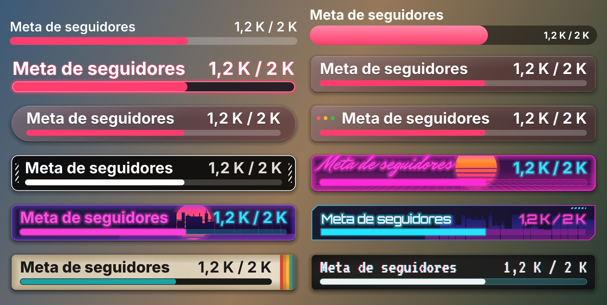

<div align="center">

# 🎯 AC Goal Bar

**Una barra de progreso para OBS Studio que avanza en vivo hacia tu meta en YouTube, Twitch o Kick (me gusta, suscriptores, seguidores, espectadores, comentarios o bits) y celebra cuando la alcanzas.**

[](../../releases/latest)


[](LICENSE)
[](https://ko-fi.com/alejoxcode)

[English](README.md) · **Español**



[**⬇️ Descargar**](../../releases/latest) &nbsp;·&nbsp; [Instalar](#-instalar) &nbsp;·&nbsp; [Qué incluye](#-qué-incluye) &nbsp;·&nbsp; [Preguntas frecuentes](#-preguntas-frecuentes)

</div>

---

Una fuente nativa de OBS (sin fuente de navegador, sin página web, sin app aparte). YouTube y Kick no necesitan cuenta ni claves; Twitch se conecta una vez con un código.

## ✨ Qué incluye

| | Función | Qué hace |
|:-:|---------|----------|
| 📊 | **Fuente «Barra de meta»** | Una fuente de OBS con título, valor actual / meta y una barra que se llena con una animación suave. Estilos: Minimalista, Intenso y Neón (solo la barra) y los mismos estilos de tarjeta que multi-chat y Music Now Playing — Cristal, Píldora, Ventana macOS, Línea, Synthwave, Ciudad neón, Cyberpunk, Retro y Glitch (VHS, con sus saltos) — y los dos estilos GTA 6 (Vice City) de Music Now Playing, uno con vinilo —, con opacidad del fondo, color de acento y de texto, y tamaño |
| ▶️ | **YouTube, modo público** | Lee los me gusta y los suscriptores del directo desde la página pública del canal (`@usuario`), sin iniciar sesión |
| 🟣 | **Twitch** | Seguidores y suscriptores con la API oficial. Conectas tu cuenta con un código en twitch.tv/activate |
| 🟢 | **Kick** | Seguidores y espectadores de cualquier canal, sin cuenta ni app de Kick (endpoint público no documentado, ver abajo) |
| 💬 | **Metas del chat** | **Comentarios** (YouTube, Twitch, Kick) con un mínimo de caracteres que eliges, **Bits** (Twitch) y **Suscripciones de pago** (membresías de YouTube, suscripciones de Kick), contados desde el chat en vivo mientras OBS está abierto |
| ✍️ | **Modo manual** | Escribes el valor actual a mano; siempre disponible |
| 🎉 | **Celebración** | Al cumplir la meta: brillo y confeti sobre la barra |
| 🎬 | **Mostrar una fuente** | Muestra una fuente de la escena (imagen, texto, audio o video). Audio y video se reproducen desde el inicio y se ocultan al terminar |
| 🔀 | **Más acciones (opcionales)** | Cambiar de escena (y volver tras N s), guardar un clip del búfer de repetición, tomar una captura. Todas desactivadas por defecto; la prueba nunca guarda clips |
| ⏭️ | **Siguiente meta automática** | Tras la celebración, la meta sube según el incremento que elijas |
| ⌨️ | **Atajos de teclado** | «Barra de meta: Probar celebración» y «Barra de meta: Reiniciar meta», por fuente |
| 🔄 | **Actualizaciones** | Revisa GitHub una vez al día e instala la versión nueva al reiniciar OBS, si aceptas |
| 🌍 | **Traducciones** | Interfaz en inglés y español |

> [!NOTE]
> **YouTube redondea los suscriptores** (por ejemplo, 12,3 K), incluso para el dueño del canal. Por eso una meta de suscriptores se ajusta al siguiente valor que YouTube puede mostrar. Los me gusta son exactos y son la métrica por defecto.

## 📦 Instalar

### Requisitos

| Sistema | Necesita |
|---|---|
| **macOS** | macOS 13 o posterior en Apple Silicon (M1 o más nuevo), OBS Studio 33 o posterior. No funciona en Mac con Intel |
| **Windows** | Windows 10 u 11 de 64 bits, OBS Studio 33 o posterior |
| **Linux** | x86_64, Ubuntu 24.04 o posterior, con OBS Studio del [PPA oficial de OBS](https://launchpad.net/~obsproject/+archive/ubuntu/obs-studio) (el paquete se compila contra él). El inicio de sesión de Twitch necesita además `libsecret` y un Secret Service activo (GNOME Keyring o KWallet) |

Descarga el paquete de tu sistema desde **[Releases](../../releases/latest)** y **cierra OBS antes** (OBS no puede reemplazar un plugin que ya cargó).

### macOS

1. Descarga `obs-goal-bar-<versión>-macos-arm64.zip` y descomprímelo: queda `obs-goal-bar.plugin`.
2. En Finder, pulsa <kbd>⌘</kbd> <kbd>⇧</kbd> <kbd>G</kbd>, pega `~/Library/Application Support/obs-studio/plugins/` y pulsa Intro. Crea la carpeta `plugins` si no existe.
3. Copia `obs-goal-bar.plugin` en esa carpeta (si actualizas a mano, reemplaza el anterior).
4. El paquete no está firmado con una cuenta de desarrollador de Apple de pago, así que quita la marca de cuarentena una vez en la Terminal:

   ```bash
   xattr -dr com.apple.quarantine ~/Library/Application\ Support/obs-studio/plugins/obs-goal-bar.plugin
   ```

5. Abre OBS.

### Windows

1. Descarga `obs-goal-bar-<versión>-windows-x64.zip` y extráelo: queda la carpeta `obs-goal-bar`.
2. Copia esa carpeta en `C:\ProgramData\obs-studio\plugins\`. `ProgramData` está oculta: escribe la ruta en la barra del Explorador y crea la carpeta `plugins` si no existe.
3. Comprueba que exista este archivo: `C:\ProgramData\obs-studio\plugins\obs-goal-bar\bin\64bit\obs-goal-bar.dll`.
4. Abre OBS.

### Linux

1. Descarga `obs-goal-bar-<versión>-linux-x86_64.tar.gz`.
2. Extráelo en tu carpeta de plugins de OBS:

   ```bash
   mkdir -p ~/.config/obs-studio/plugins
   tar -xzf obs-goal-bar-<versión>-linux-x86_64.tar.gz -C ~/.config/obs-studio/plugins
   ```

3. Abre OBS.

### Comprobar que cargó

En OBS, **Ayuda → Archivos de registro → Ver registro actual** debe mostrar `[obs-goal-bar] loaded (version …)`, y **Barra de meta** aparece al pulsar **+** en Fuentes. Los paquetes de Windows y Linux traen también estos pasos en `INSTALL.txt`.

**Desinstalar:** cierra OBS y borra `obs-goal-bar.plugin` (macOS) o la carpeta `obs-goal-bar` (Windows, Linux) de la carpeta de plugins de arriba.

## 🚀 Uso en 5 pasos

1. **Añade la fuente.** En una escena, pulsa **+** y elige **Barra de meta**.
2. **Elige la plataforma.** **Manual**, **YouTube** (escribe tu `@usuario`), **Twitch** (pulsa **Conectar Twitch** e ingresa el código en twitch.tv/activate) o **Kick** (escribe el nombre del canal; ver abajo).
3. **Fija la meta.** Elige la métrica y escribe la **Meta**.
4. **Decide qué pasa al cumplirla.** En **Al cumplir la meta**: animación, una fuente para mostrar y la siguiente meta automática. Pulsa **Probar celebración** para verlo.
5. **Asigna atajos (opcional).** En **Ajustes → Atajos**, busca la fuente y asigna «Probar celebración» y «Reiniciar meta».

> [!TIP]
> La barra siempre muestra actual / meta, igual que su texto. **Reiniciar meta** vuelve a armar la celebración de la meta actual (y, con «Siguiente meta automática», sube por el incremento una meta ya cumplida). Nunca dispara la celebración por sí sola, aunque el valor ya esté en la meta.

### 🟣 Twitch

Los seguidores funcionan con cualquier cuenta. Los suscriptores necesitan un canal Afiliado o Partner de Twitch; si no, la barra lo indica.

### 💬 Comentarios, bits y suscripciones de pago

Elige la métrica **Comentarios** (YouTube, Twitch o Kick), **Bits** (Twitch) o **Suscripciones de pago** (YouTube o Kick). La barra los cuenta desde el chat en vivo, igual que lo lee multi-chat:

- **Comentarios**: cada mensaje con al menos **Mínimo de caracteres por comentario** (5 por defecto; no cuentan los espacios del principio y del final, y cada emote o emoji cuenta como un carácter).
- **Bits**: los bits de cada cheer del chat. No hace falta ningún permiso extra de Twitch: el chat se lee de forma anónima, así que no tienes que reconectar la cuenta.
- **Suscripciones de pago**: membresías del canal en YouTube y suscripciones en Kick. Cada nueva, cada renovación y cada regalada suma 1 (un regalo de 5 suma 5). YouTube y Kick no publican el total de suscriptores de pago, así que se cuentan desde el chat. En Twitch, **Suscriptores** ya es el total de pago (lo da la API de Twitch); en YouTube, **Suscriptores** son los gratuitos.
- Solo se cuenta lo que pasa **mientras OBS está abierto**. Al cambiar una fuente a una de estas métricas empieza en 0; cambia **Valor actual** para empezar desde otro número (por ejemplo, tu número actual de miembros).
- Twitch lee el chat de la cuenta conectada; YouTube el directo del `@usuario` (espera mientras el canal no está en vivo); Kick el chat del canal que escribiste.

### 🟢 Kick

Elige **Kick** y escribe el nombre del canal (o pega su URL de kick.com). No necesitas cuenta, app ni credenciales de Kick.

Métricas: **Seguidores** (disponibles en todo momento) y **Espectadores** (se muestran mientras el canal está en directo; si no, «Sin directo»). Los suscriptores de pago no se ofrecen: Kick no los publica en este endpoint. La barra se actualiza cada 20 segundos aproximadamente y espera más (hasta 5 minutos) si Kick limita o bloquea las solicitudes.

> [!WARNING]
> Los datos de Kick vienen de un endpoint público **no documentado** (`kick.com/api/v2/channels/<canal>`), el mismo que usa la web de Kick. No forma parte de su API oficial, está detrás de Cloudflare y puede cambiar o dejar de funcionar en cualquier momento. Si Kick bloquea la solicitud, la barra muestra «Kick bloqueó la solicitud» en lugar de un valor falso.

## 🔄 Actualizaciones

- **Automáticas.** Al abrir OBS, el plugin consulta la última versión publicada en GitHub, como mucho una vez al día. Si hay una nueva, te muestra un aviso con las notas de la versión y tres opciones: **Instalar al reiniciar**, **Más tarde** u **Omitir esta versión**.
- **Manual.** En **Herramientas → AC Goal Bar: Buscar actualizaciones**.
- **Cómo se aplica.** Al elegir **Instalar al reiniciar**, el paquete se descarga de las Releases de este repositorio en GitHub y se verifica con el SHA-256 que publica GitHub. Se instala cuando cierras OBS y queda activo al volver a abrirlo. Si algo falla, se restaura la versión anterior.

> [!NOTE]
> Solo se actualiza sola una instalación hecha como en las instrucciones de arriba (no dentro de la carpeta del programa OBS ni desde un paquete de la distribución), y tu usuario debe poder escribir en ella. Si no, el aviso enlaza a la página de la versión para descargarla a mano.

## ❓ Preguntas frecuentes

<details>
<summary><b>En YouTube la barra dice «Sin directo» o no se mueve</b></summary>

Los me gusta y los suscriptores de YouTube se leen de tu página pública `/@usuario/live`, así que el canal debe estar en directo y la transmisión debe ser pública. Revisa el `@usuario` en las propiedades de la fuente.
</details>

<details>
<summary><b>No aparecen los suscriptores de Twitch</b></summary>

Twitch solo da el número de suscriptores de canales Afiliados o Partner. Los seguidores funcionan con cualquier canal.
</details>

<details>
<summary><b>Kick dice «Kick bloqueó la solicitud»</b></summary>

El endpoint de Kick está detrás de Cloudflare y a veces rechaza solicitudes. La barra conserva el último valor y reintenta con esperas más largas (hasta 5 minutos).
</details>

<details>
<summary><b>macOS dice que el plugin está dañado o no lo carga</b></summary>

Ejecuta el comando `xattr -dr com.apple.quarantine …` de los pasos de instalación. El paquete de macOS es solo para Apple Silicon.
</details>

<details>
<summary><b>OBS dice que no pudo cargar el plugin, o «Barra de meta» no aparece en las fuentes</b></summary>

1. Revisa tu versión de OBS (**Ayuda → Acerca de**): debe ser la 33 o posterior. En Linux, usa el OBS del PPA oficial; el paquete `obs-studio` que trae la distribución suele ser más antiguo y no puede cargar este plugin.
2. Compara la carpeta con los [pasos de instalación](#-instalar). El error más común es una carpeta de más o de menos: en Windows el archivo debe quedar en `…\plugins\obs-goal-bar\bin\64bit\obs-goal-bar.dll`; en macOS el `.plugin` va directamente dentro de `plugins`.
3. En macOS, ejecuta el comando `xattr -dr com.apple.quarantine …` de los pasos de instalación. El paquete de macOS es solo para Apple Silicon.
4. Abre **Ayuda → Archivos de registro → Ver registro actual** y busca `obs-goal-bar`. Si no aparece la línea `[obs-goal-bar] loaded`, [abre un issue](../../issues) con las líneas que mencionan el plugin.
</details>

<details>
<summary><b>Los comentarios o los bits no cuentan</b></summary>

Se cuentan desde el chat en vivo solo mientras OBS está abierto. Twitch necesita la cuenta conectada en las propiedades de la fuente; YouTube, que el canal esté en directo con el chat activado; en Kick, revisa el nombre del canal. El registro de OBS muestra líneas como `[obs-goal-bar] twitch chat comments: live` o el error que detuvo el chat.
</details>

## 🔐 Privacidad

AC Goal Bar no tiene telemetría ni cuenta propia. Solo se conecta a los servicios de abajo: la plataforma que usa cada fuente, y GitHub para las actualizaciones.

**A qué se conecta**

| Servicio | Cuándo | Para qué |
|---|---|---|
| **YouTube** (`www.youtube.com`) | Una fuente usa YouTube | Lee la página pública `/@usuario/live` (me gusta y suscriptores) y, en una meta de comentarios, el chat público del directo. Sin iniciar sesión ni clave de API |
| **Twitch** (`id.twitch.tv`, `api.twitch.tv`) | Conectas Twitch | Inicio de sesión con un código en twitch.tv/activate y, después, seguidores y suscriptores de tu canal con la API oficial |
| **Chat de Twitch** (`irc-ws.chat.twitch.tv`) | Una fuente de Twitch cuenta comentarios o bits | Lee el chat de tu canal de forma anónima y solo lectura (nunca escribe en él) |
| **Kick** (`kick.com`, `web.kick.com` y el chat de Kick en `ws-*.pusher.com`) | Una fuente usa Kick | Lee los datos públicos del canal (seguidores, espectadores) y, en una meta de comentarios, su chat público. Sin cuenta |
| **GitHub** (`api.github.com`, `github.com`) | Al abrir OBS (como mucho una vez al día) y cuando buscas actualizaciones | Busca una versión nueva y, si aceptas, la descarga (GitHub puede servir el archivo desde sus servidores de descarga). La solicitud lleva la versión del plugin (`obs-goal-bar-updater/<versión>`) |

A estos servicios solo se les envían las propias solicitudes: tu `@usuario` o nombre de canal a la plataforma que elegiste, y tu token de Twitch a Twitch.

**Qué guarda en tu equipo**

| Qué | Dónde |
|---|---|
| Los ajustes de la fuente (título, plataforma, `@usuario` o canal, métrica, valores de la meta, estilo, acciones) | En la colección de escenas de OBS, como cualquier otra fuente |
| La sesión de Twitch: el token de renovación y tu usuario de Twitch (id, login, nombre visible, tipo de canal) | En el llavero del sistema, bajo `com.alejox.obs-goal-bar` (Llavero de macOS, Administrador de credenciales de Windows o el Secret Service de Linux), nunca en texto plano. El token de acceso solo vive en memoria. **Desconectar Twitch** en las propiedades de la fuente los borra |
| Ajustes de actualización (`update.json`: revisión automática activada o no, última revisión, versión omitida), el resultado de la última actualización (`update-result.txt`) y una actualización descargada pendiente de instalar (`update/`) | En la carpeta de ajustes del plugin en OBS (`plugin_config/obs-goal-bar`) |

## 🧭 Estado

Cada versión se prueba dentro de OBS en macOS (Apple Silicon), Windows x64 y Linux x86_64, y los tres paquetes se compilan, prueban y empaquetan en CI (GitHub Actions) desde el mismo commit.

## 🐞 Reportar un problema

Abre un [issue en GitHub](../../issues) con:

- tu sistema (macOS, Windows o Linux, y su versión), tu versión de OBS y la versión de AC Goal Bar (la muestra **Herramientas → AC Goal Bar: Buscar actualizaciones**);
- qué hiciste y qué esperabas;
- las líneas que mencionan `obs-goal-bar` en **Ayuda → Archivos de registro → Ver registro actual**.

## 🛠️ Compilar desde el código

<details>
<summary><b>Compilación y pruebas</b></summary>

macOS: macOS 13 o posterior en Apple Silicon, Xcode y CMake 3.28 o posterior.

```sh
cmake --preset macos
cmake --build --preset macos
```

El paquete queda en `build_macos/RelWithDebInfo/obs-goal-bar.plugin`. Windows y Linux se compilan en `.github/workflows/build.yml`.

El núcleo no depende de OBS ni de Qt, y sus pruebas se compilan con CMake a secas:

```sh
cmake -S tests -B build_tests
cmake --build build_tests
ctest --test-dir build_tests --output-on-failure
```
</details>

## ☕ Apoyar

AC Goal Bar es gratis y lo va a seguir siendo. Si te ahorra tiempo en tus directos, puedes [invitarme un café en Ko-fi](https://ko-fi.com/alejoxcode): paga horas de desarrollo y las próximas funciones. El plugin nunca lo pide solo; el enlace es el último botón de las Propiedades de la fuente Barra de meta.

## 🤖 Cómo está hecho este plugin

AC Goal Bar se desarrolla con la ayuda de un asistente de programación con IA (Anthropic Claude, mediante Claude Code), dirigido por el mantenedor: gran parte del código se escribió con él. La IA se usó para escribir y modificar el código C++ del plugin y sus pruebas, los workflows de compilación y publicación, y la documentación, incluido este README. Alejandro (Alejoxgaming) diseña las funciones, revisa los cambios, prueba cada versión en OBS en sus propios directos en Windows, macOS y Linux, decide qué se publica y mantiene el proyecto. El historial de commits muestra qué cambios se hicieron con ayuda de IA.

Si encuentras un fallo, [abre un issue](../../issues): cada reporte lo lee y lo responde una persona.

## 📄 Licencia

GPL-2.0 o posterior, como todo plugin que enlaza con libobs: mira [LICENSE](LICENSE).

AC Goal Bar es un plugin independiente, de terceros, para OBS Studio; no tiene relación con OBS Project, YouTube, Twitch ni Kick, ni está respaldado por ellos. Los estilos «GTA 6 (Vice City)» son un diseño original inspirado en los colores del juego; no usan ilustraciones ni logotipos de Rockstar Games, y AC Goal Bar no tiene relación con Rockstar Games ni con Take-Two Interactive. Todas las marcas pertenecen a sus dueños.
