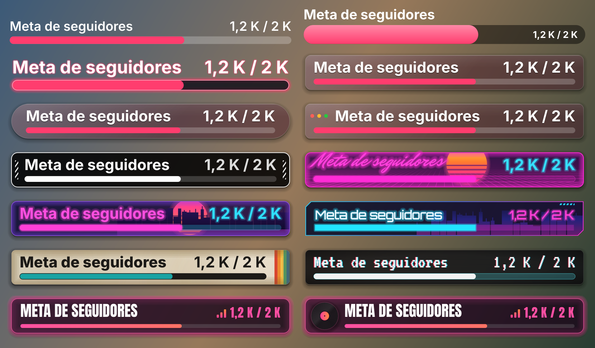

<div align="center">

# 🎯 AC Goal Bar

**A native OBS progress bar that moves live toward your likes, subscribers or followers goal on YouTube, Twitch or Kick, and celebrates when you reach it.**

[](../../releases/latest)


[](LICENSE)

**English** · [Español](README.es.md)



[**⬇️ Download**](../../releases/latest) &nbsp;·&nbsp; [Install](#-install) &nbsp;·&nbsp; [Features](#-features) &nbsp;·&nbsp; [FAQ](#-faq)

</div>

---

A native OBS source (no browser source, no web page, no external app). YouTube and Kick need no account or keys; Twitch connects with a one-time code.

## ✨ Features

| | Feature | What it does |
|:-:|---------|--------------|
| 📊 | **"Goal Bar" source** | An OBS source with a title, current value / goal and a bar that fills with a smooth animation. Styles: Minimal, Bold and Neon (just the bar) plus the same card styles as multi-chat and Music Now Playing — Glass, Pill, macOS window, Line, Synthwave, Neon city, Cyberpunk, Retro and Glitch (VHS, with its jumps) — and the two GTA 6 (Vice City) styles from Music Now Playing, one with a vinyl record — with background opacity, accent and text color, and size |
| ▶️ | **YouTube, public mode** | Reads the live stream's likes and subscribers from the channel's public page (`@handle`), no sign-in |
| 🟣 | **Twitch** | Followers and subscribers through the official API. Connect your account with a code on twitch.tv/activate |
| 🟢 | **Kick** | Followers and viewers of any channel, no Kick account or app needed (undocumented public endpoint, see below) |
| ✍️ | **Manual mode** | Type the current value yourself; always available |
| 🎉 | **Celebration** | When the goal is reached: a glow and confetti over the bar |
| 🎬 | **Show a source** | Shows a scene source (image, text, audio or video). Audio and video play from the start and hide when they end |
| 🔀 | **More actions (optional)** | Switch scene (and back after N s), save a Replay Buffer clip, take a screenshot. All off by default; tests never save clips |
| ⏭️ | **Auto next goal** | After the celebration, the goal moves up by the step you choose |
| ⌨️ | **Hotkeys** | "Goal Bar: Test celebration" and "Goal Bar: Reset goal", per source |
| 🔄 | **Updates** | Checks GitHub once a day and installs a new version on the next OBS restart, after you accept |
| 🌍 | **Translations** | English and Spanish UI |

> [!NOTE]
> **YouTube rounds subscriber counts** (for example, 12.3K), even for the channel owner. A subscribers goal is therefore aligned to the next value YouTube can show. Likes are exact and are the default metric.

## 📦 Install

Download the package for your system from **[Releases](../../releases/latest)** and **quit OBS first** (OBS cannot replace a plugin it already loaded).

| | macOS 13+ (Apple Silicon) | Windows x64 (OBS 33+) | Linux x86_64 |
|---|---|---|---|
| **File** | `obs-goal-bar-<version>-macos-arm64.zip` | `obs-goal-bar-<version>-windows-x64.zip` | `obs-goal-bar-<version>-linux-x86_64.tar.gz` |
| **You get** | `obs-goal-bar.plugin` | the `obs-goal-bar` folder | the `obs-goal-bar` folder |
| **Copy it to** | `~/Library/Application Support/obs-studio/plugins/` | `C:\ProgramData\obs-studio\plugins\` | `~/.config/obs-studio/plugins/` |
| **Then** | Run the Terminal command below (once) | — | — |

Each package also contains its steps as `INSTALL.txt`. Open OBS: **Help → Log Files → View Current Log** should show `[obs-goal-bar] loaded`.

**macOS:** in Finder, press <kbd>⌘</kbd> <kbd>⇧</kbd> <kbd>G</kbd> and paste the path; create the `plugins` folder if it doesn't exist. The bundle isn't signed with a paid Apple developer account, so clear the quarantine flag once:

```bash
xattr -dr com.apple.quarantine ~/Library/Application\ Support/obs-studio/plugins/obs-goal-bar.plugin
```

**Windows:** the result must be `C:\ProgramData\obs-studio\plugins\obs-goal-bar\bin\64bit\obs-goal-bar.dll` (`ProgramData` is hidden: type the path in the Explorer address bar). The Twitch refresh token is kept in the Windows Credential Manager.

**Linux:** built on Ubuntu 24.04 against the OBS from the [official PPA](https://launchpad.net/~obsproject/+archive/ubuntu/obs-studio).

```bash
mkdir -p ~/.config/obs-studio/plugins
tar -xzf obs-goal-bar-<version>-linux-x86_64.tar.gz -C ~/.config/obs-studio/plugins
```

Twitch login on Linux needs `libsecret` and a running Secret Service (GNOME Keyring or KWallet); without one, the token isn't saved (it's never kept in plain text).

**Uninstall:** delete `obs-goal-bar.plugin` (macOS) or the `obs-goal-bar` folder (Windows, Linux) from the plugins folder above.

## 🚀 Use it in 5 steps

1. **Add the source.** In a scene, click **+** and pick **Goal Bar**.
2. **Pick the platform.** **Manual**, **YouTube** (type your `@handle`), **Twitch** (click **Connect Twitch** and enter the code on twitch.tv/activate) or **Kick** (type the channel name, see below).
3. **Set the goal.** Choose the metric and type the **Goal**.
4. **Decide what happens when it is reached.** Under **When the goal is reached**: the animation, a source to show and the auto next goal. Click **Test celebration** to preview it.
5. **Assign hotkeys (optional).** In **Settings → Hotkeys**, find the source and bind "Test celebration" and "Reset goal".

> [!TIP]
> The bar always shows current / goal, like its label. **Reset goal** re-arms the celebration for the current goal (and, with "Auto next goal", moves an already reached goal up by the step). It never fires the celebration itself, even when the value is already at the goal.

### 🟣 Twitch

Followers work with any account. Subscribers need a Twitch Affiliate or Partner channel; otherwise the bar says so.

### 🟢 Kick

Pick **Kick** and type the channel name (or paste its kick.com URL). No Kick account, app or credentials are needed.

Metrics: **Followers** (readable at any time) and **Viewers** (shown while the channel is live; "Offline" otherwise). Paid subscribers are not offered: Kick does not publish them on this endpoint. The bar refreshes about every 20 seconds and waits longer (up to 5 minutes) if Kick limits or blocks requests.

> [!WARNING]
> Kick data comes from an **undocumented** public endpoint (`kick.com/api/v2/channels/<channel>`), the one Kick's own website uses. It is not part of Kick's official API, sits behind Cloudflare and may change or stop working at any time. If Kick blocks the request, the bar shows "Kick blocked the request" instead of a made-up value.

## 🔄 Updates

- **Automatic.** When OBS starts, the plugin checks the latest release on GitHub, at most once a day. If there is a newer one, it shows a notice with the release notes and three choices: **Install on next restart**, **Later** or **Skip this version**.
- **Manual.** Use **Tools → Goal Bar: Check for updates**.
- **How it applies.** After **Install on next restart**, the package is downloaded from this repository's GitHub Releases and verified against the SHA-256 GitHub publishes. It is installed when you close OBS and is active the next time you open it. If any step fails, the previous version is put back.

> [!NOTE]
> Only an install made as in the instructions above (not inside the OBS program folder or from a distribution package) updates itself, and your user must be able to write to it. Otherwise the notice links to the release page for a manual download.

## ❓ FAQ

<details>
<summary><b>The bar says "Offline" or doesn't move on YouTube</b></summary>

YouTube likes and subscribers are read from your public `/@handle/live` page, so the channel must be live and the stream public. Check the `@handle` in the source properties.
</details>

<details>
<summary><b>Twitch subscribers don't show</b></summary>

Twitch only gives subscriber counts for Affiliate or Partner channels. Followers work for every channel.
</details>

<details>
<summary><b>Kick says "Kick blocked the request"</b></summary>

Kick's endpoint sits behind Cloudflare and sometimes refuses requests. The bar keeps the last value and retries with longer waits (up to 5 minutes).
</details>

<details>
<summary><b>macOS says the plugin is damaged or doesn't load it</b></summary>

Run the `xattr -dr com.apple.quarantine …` command from the install steps. The macOS package is for Apple Silicon only.
</details>

## 🔐 Privacy

| Data | Where it goes |
|------|---------------|
| Twitch login | The refresh token lives in the system keychain (macOS Keychain, Windows Credential Manager or the Linux Secret Service); the access token only in memory |
| YouTube | The public live page is read; no sign-in, no keys |
| Network | The plugin only talks to youtube.com, twitch.tv (id.twitch.tv and api.twitch.tv), kick.com and github.com (to check for and download updates). It sends no data anywhere else, and there's no telemetry |

## 🧭 Status

macOS (Apple Silicon) is tested inside OBS. Windows x64 and Linux x86_64 are built, unit-tested and packaged in CI (GitHub Actions); reports from those systems are welcome in [Issues](../../issues).

## 🛠️ Build from source

<details>
<summary><b>Build and tests</b></summary>

macOS: macOS 13 or later on Apple Silicon, Xcode and CMake 3.28 or later.

```sh
cmake --preset macos
cmake --build --preset macos
```

The bundle is written to `build_macos/RelWithDebInfo/obs-goal-bar.plugin`. Windows and Linux are built by `.github/workflows/build.yml`.

The core depends on neither OBS nor Qt, and its tests build with plain CMake:

```sh
cmake -S tests -B build_tests
cmake --build build_tests
ctest --test-dir build_tests --output-on-failure
```
</details>

## 📄 License

GPL-2.0-or-later, like every plugin that links against libobs. See [LICENSE](LICENSE).

AC Goal Bar is an independent project, not affiliated with or endorsed by the OBS Project, YouTube, Twitch or Kick.
