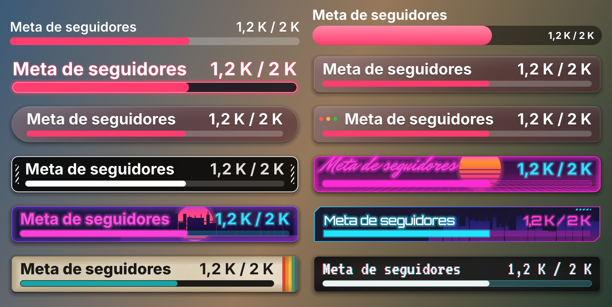

<div align="center">

# 🎯 AC Goal Bar

**A progress bar for OBS Studio that moves live toward your goal on YouTube, Twitch or Kick (likes, subscribers, followers, viewers, comments or bits) and celebrates when you reach it.**

[](../../releases/latest)


[](LICENSE)
[](https://ko-fi.com/alejoxcode)

**English** · [Español](README.es.md)



[**⬇️ Download**](../../releases/latest) &nbsp;·&nbsp; [Install](#-install) &nbsp;·&nbsp; [Features](#-features) &nbsp;·&nbsp; [FAQ](#-faq)

</div>

---

A native OBS source (no browser source, no web page, no external app). YouTube and Kick need no account or keys; Twitch connects with a one-time code.

## ✨ Features

| | Feature | What it does |
|:-:|---------|--------------|
| 📊 | **"Goal Bar" source** | An OBS source with a title, current value / goal and a bar that fills with a smooth animation. Styles: Minimal, Bold and Neon (just the bar) plus the same card styles as multi-chat and Music Now Playing — Glass, Pill, macOS window, Line, Synthwave, Neon city, Cyberpunk, Retro and Glitch (VHS, with its jumps) — and the two GTA 6 (Vice City) styles from Music Now Playing, one with a vinyl record — with background opacity, accent and text color, and size |
| ▶️ | **YouTube, public mode** | Reads the live stream's likes and subscribers from the channel's public page (`@handle`), no sign-in |
| 🟣 | **Twitch** | Followers and subscribers through the official API. Connect your account with a code on twitch.tv/activate |
| 🟢 | **Kick** | Followers and viewers of any channel, no Kick account or app needed (undocumented public endpoint, see below) |
| 💬 | **Chat goals** | **Comments** (YouTube, Twitch, Kick) with a minimum length you choose, and **Bits** (Twitch), counted from the live chat while OBS is open |
| ✍️ | **Manual mode** | Type the current value yourself; always available |
| 🎉 | **Celebration** | When the goal is reached: a glow and confetti over the bar |
| 🎬 | **Show a source** | Shows a scene source (image, text, audio or video). Audio and video play from the start and hide when they end |
| 🔀 | **More actions (optional)** | Switch scene (and back after N s), save a Replay Buffer clip, take a screenshot. All off by default; tests never save clips |
| ⏭️ | **Auto next goal** | After the celebration, the goal moves up by the step you choose |
| ⌨️ | **Hotkeys** | "Goal Bar: Test celebration" and "Goal Bar: Reset goal", per source |
| 🔄 | **Updates** | Checks GitHub once a day and installs a new version on the next OBS restart, after you accept |
| 🌍 | **Translations** | English and Spanish UI |

> [!NOTE]
> **YouTube rounds subscriber counts** (for example, 12.3K), even for the channel owner. A subscribers goal is therefore aligned to the next value YouTube can show. Likes are exact and are the default metric.

## 📦 Install

### Requirements

| System | Needs |
|---|---|
| **macOS** | macOS 13 or later on Apple Silicon (M1 or newer), OBS Studio 33 or later. Intel Macs are not supported |
| **Windows** | Windows 10 or 11, 64-bit, OBS Studio 33 or later |
| **Linux** | x86_64, Ubuntu 24.04 or later, with OBS Studio from the [official OBS PPA](https://launchpad.net/~obsproject/+archive/ubuntu/obs-studio) (the package is built against it). Twitch login also needs `libsecret` and a running Secret Service (GNOME Keyring or KWallet) |

Download the package for your system from **[Releases](../../releases/latest)** and **quit OBS first** (OBS cannot replace a plugin it already loaded).

### macOS

1. Download `obs-goal-bar-<version>-macos-arm64.zip` and unzip it: you get `obs-goal-bar.plugin`.
2. In Finder, press <kbd>⌘</kbd> <kbd>⇧</kbd> <kbd>G</kbd>, paste `~/Library/Application Support/obs-studio/plugins/` and press Enter. Create the `plugins` folder if it doesn't exist.
3. Copy `obs-goal-bar.plugin` into that folder (replace the old one when updating by hand).
4. The bundle isn't signed with a paid Apple developer account, so clear the quarantine flag once in Terminal:

   ```bash
   xattr -dr com.apple.quarantine ~/Library/Application\ Support/obs-studio/plugins/obs-goal-bar.plugin
   ```

5. Open OBS.

### Windows

1. Download `obs-goal-bar-<version>-windows-x64.zip` and extract it: you get the `obs-goal-bar` folder.
2. Copy that folder into `C:\ProgramData\obs-studio\plugins\`. `ProgramData` is hidden: type the path in the Explorer address bar, and create the `plugins` folder if it doesn't exist.
3. Check that this file exists: `C:\ProgramData\obs-studio\plugins\obs-goal-bar\bin\64bit\obs-goal-bar.dll`.
4. Open OBS.

### Linux

1. Download `obs-goal-bar-<version>-linux-x86_64.tar.gz`.
2. Extract it into your OBS plugins folder:

   ```bash
   mkdir -p ~/.config/obs-studio/plugins
   tar -xzf obs-goal-bar-<version>-linux-x86_64.tar.gz -C ~/.config/obs-studio/plugins
   ```

3. Open OBS.

### Check that it loaded

In OBS, **Help → Log Files → View Current Log** should show `[obs-goal-bar] loaded (version …)`, and **Goal Bar** appears when you click **+** under Sources. The Windows and Linux packages also contain these steps as `INSTALL.txt`.

**Uninstall:** quit OBS and delete `obs-goal-bar.plugin` (macOS) or the `obs-goal-bar` folder (Windows, Linux) from the plugins folder above.

## 🚀 Use it in 5 steps

1. **Add the source.** In a scene, click **+** and pick **Goal Bar**.
2. **Pick the platform.** **Manual**, **YouTube** (type your `@handle`), **Twitch** (click **Connect Twitch** and enter the code on twitch.tv/activate) or **Kick** (type the channel name, see below).
3. **Set the goal.** Choose the metric and type the **Goal**.
4. **Decide what happens when it is reached.** Under **When the goal is reached**: the animation, a source to show and the auto next goal. Click **Test celebration** to preview it.
5. **Assign hotkeys (optional).** In **Settings → Hotkeys**, find the source and bind "Test celebration" and "Reset goal".

> [!TIP]
> The bar always shows current / goal, like its label. **Reset goal** re-arms the celebration for the current goal (and, with "Auto next goal", moves an already reached goal up by the step). It never fires the celebration itself, even when the value is already at the goal.

### 🟣 Twitch

Followers work with any account. Subscribers need a Twitch Affiliate or Partner channel; otherwise the bar says so.

### 💬 Comments and bits

Pick the metric **Comments** (YouTube, Twitch or Kick) or **Bits** (Twitch). The bar counts them from the live chat, the same way multi-chat reads it:

- **Comments**: every message with at least **Minimum characters per comment** (5 by default; leading and trailing spaces don't count, each emote or emoji counts as one character).
- **Bits**: the bits of every cheer in the chat. No extra Twitch permission is needed: the chat is read anonymously, so you don't have to reconnect your account.
- Only what happens **while OBS is open** is counted. Switching a source to comments or bits starts at 0; change **Current value** to start from another number.
- Twitch reads the chat of the connected account; YouTube the live stream of the `@handle` (it waits while the channel is offline); Kick the chat of the channel you typed.

### 🟢 Kick

Pick **Kick** and type the channel name (or paste its kick.com URL). No Kick account, app or credentials are needed.

Metrics: **Followers** (readable at any time) and **Viewers** (shown while the channel is live; "Offline" otherwise). Paid subscribers are not offered: Kick does not publish them on this endpoint. The bar refreshes about every 20 seconds and waits longer (up to 5 minutes) if Kick limits or blocks requests.

> [!WARNING]
> Kick data comes from an **undocumented** public endpoint (`kick.com/api/v2/channels/<channel>`), the one Kick's own website uses. It is not part of Kick's official API, sits behind Cloudflare and may change or stop working at any time. If Kick blocks the request, the bar shows "Kick blocked the request" instead of a made-up value.

## 🔄 Updates

- **Automatic.** When OBS starts, the plugin checks the latest release on GitHub, at most once a day. If there is a newer one, it shows a notice with the release notes and three choices: **Install on next restart**, **Later** or **Skip this version**.
- **Manual.** Use **Tools → AC Goal Bar: Check for updates**.
- **How it applies.** After **Install on next restart**, the package is downloaded from this repository's GitHub Releases and verified against the SHA-256 GitHub publishes. It is installed when you close OBS and is active the next time you open it. If any step fails, the previous version is put back.

> [!NOTE]
> Only an install made as in the instructions above (not inside the OBS program folder or from a distribution package) updates itself, and your user must be able to write to it. Otherwise the notice links to the release page for a manual download.

## ❓ FAQ

<details>
<summary><b>The bar says "Offline" or doesn't move on YouTube</b></summary>

YouTube likes and subscribers are read from your public `/@handle/live` page, so the channel must be live and the stream public. Check the `@handle` in the source properties.
</details>

<details>
<summary><b>Twitch subscribers don't show</b></summary>

Twitch only gives subscriber counts for Affiliate or Partner channels. Followers work for every channel.
</details>

<details>
<summary><b>Kick says "Kick blocked the request"</b></summary>

Kick's endpoint sits behind Cloudflare and sometimes refuses requests. The bar keeps the last value and retries with longer waits (up to 5 minutes).
</details>

<details>
<summary><b>macOS says the plugin is damaged or doesn't load it</b></summary>

Run the `xattr -dr com.apple.quarantine …` command from the install steps. The macOS package is for Apple Silicon only.
</details>

<details>
<summary><b>OBS says the plugin could not be loaded, or "Goal Bar" doesn't appear in the sources</b></summary>

1. Check your OBS version (**Help → About**): it must be 33 or later. On Linux, use the OBS from the official PPA; the `obs-studio` package that comes with the distribution is usually older and can't load this plugin.
2. Check the folder against the [install steps](#-install). The most common mistake is one folder too many or too few: on Windows the file must end up at `…\plugins\obs-goal-bar\bin\64bit\obs-goal-bar.dll`; on macOS the `.plugin` goes directly inside `plugins`.
3. On macOS, run the `xattr -dr com.apple.quarantine …` command from the install steps. The macOS package is for Apple Silicon only.
4. Open **Help → Log Files → View Current Log** and search for `obs-goal-bar`. If there is no `[obs-goal-bar] loaded` line, [open an issue](../../issues) with the lines that mention the plugin.
</details>

<details>
<summary><b>Comments or bits don't count</b></summary>

They are counted from the live chat only while OBS is open. Twitch needs the account connected in the source properties; YouTube needs the channel to be live with its chat on; on Kick, check the channel name. The OBS log shows lines such as `[obs-goal-bar] twitch chat comments: live` or the error that stopped the chat.
</details>

## 🔐 Privacy

AC Goal Bar has no telemetry and no account of its own. It only connects to the services below: the platform each source uses, and GitHub for updates.

**What it connects to**

| Service | When | What for |
|---|---|---|
| **YouTube** (`www.youtube.com`) | A source uses YouTube | Reads the public `/@handle/live` page (likes and subscribers) and, for a comments goal, the public live chat. No sign-in, no API key |
| **Twitch** (`id.twitch.tv`, `api.twitch.tv`) | You connect Twitch | Sign-in with a code on twitch.tv/activate, then followers and subscribers of your channel through the official API |
| **Twitch chat** (`irc-ws.chat.twitch.tv`) | A Twitch source counts comments or bits | Reads your channel's chat anonymously and read-only (it never writes in it) |
| **Kick** (`kick.com`, `web.kick.com`, Kick's chat on `ws-*.pusher.com`) | A source uses Kick | Reads the channel's public data (followers, viewers) and, for a comments goal, its public chat. No account |
| **GitHub** (`api.github.com`, `github.com`) | When OBS starts (at most once a day) and when you check for updates | Looks for a newer release and, if you accept, downloads it (GitHub may serve the file from its download servers). The request carries the plugin version (`obs-goal-bar-updater/<version>`) |

The only things sent to these services are the requests themselves: your `@handle` or channel name to the platform you chose, and your Twitch token to Twitch.

**What it saves on your computer**

| What | Where |
|---|---|
| The source settings (title, platform, `@handle` or channel, metric, goal values, style, actions) | In the OBS scene collection, like any other source |
| Twitch sign-in: the refresh token and your Twitch user (id, login, display name, channel type) | In the system keychain under `com.alejox.obs-goal-bar` (macOS Keychain, Windows Credential Manager or the Linux Secret Service), never in plain text. The access token is kept only in memory. **Disconnect Twitch** in the source properties deletes them |
| Update settings (`update.json`: automatic check on or off, last check, skipped version), the result of the last update (`update-result.txt`) and a downloaded update waiting to be installed (`update/`) | In the plugin's OBS settings folder (`plugin_config/obs-goal-bar`) |

## 🧭 Status

Every release is tested inside OBS on macOS (Apple Silicon), Windows x64 and Linux x86_64, and the three packages are built, unit-tested and packaged in CI (GitHub Actions) from the same commit.

## 🐞 Report a problem

Open an [issue on GitHub](../../issues) with:

- your system (macOS, Windows or Linux, and its version), your OBS version and the AC Goal Bar version (**Tools → AC Goal Bar: Check for updates** shows it);
- what you did and what you expected;
- the lines that mention `obs-goal-bar` in **Help → Log Files → View Current Log**.

## 🛠️ Build from source

<details>
<summary><b>Build and tests</b></summary>

macOS: macOS 13 or later on Apple Silicon, Xcode and CMake 3.28 or later.

```sh
cmake --preset macos
cmake --build --preset macos
```

The bundle is written to `build_macos/RelWithDebInfo/obs-goal-bar.plugin`. Windows and Linux are built by `.github/workflows/build.yml`.

The core depends on neither OBS nor Qt, and its tests build with plain CMake:

```sh
cmake -S tests -B build_tests
cmake --build build_tests
ctest --test-dir build_tests --output-on-failure
```
</details>

## ☕ Support

AC Goal Bar is free and will stay free. If it saves you time on your streams, you can [buy me a coffee on Ko-fi](https://ko-fi.com/alejoxcode): it pays for development hours and the next features. The plugin never asks on its own; the link is the last button in the Goal Bar source's Properties.

## 🤖 How this plugin is made

AC Goal Bar is developed with the help of an AI coding assistant (Anthropic Claude, via Claude Code), directed by the maintainer: a large part of the code was written with it. AI was used to write and modify the C++ plugin code and its tests, the build and release workflows, and the documentation, including this README. Alejandro (Alejoxgaming) designs the features, reviews the changes, tests every release in OBS on his own streams on Windows, macOS and Linux, decides what ships and maintains the project. The commit history shows which changes were AI-assisted.

If you find a bug, please [open an issue](../../issues): every report is read and answered by a person.

## 📄 License

GPL-2.0 or later, like every plugin that links against libobs — see [LICENSE](LICENSE).

AC Goal Bar is an independent, third-party plugin for OBS Studio; it is not affiliated with or endorsed by the OBS Project, YouTube, Twitch or Kick. The "GTA 6 (Vice City)" styles are an original look inspired by the game's colors; they use no Rockstar Games artwork or logos, and AC Goal Bar is not affiliated with Rockstar Games or Take-Two Interactive. All trademarks belong to their owners.
